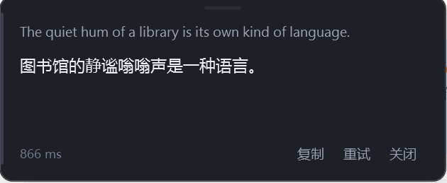
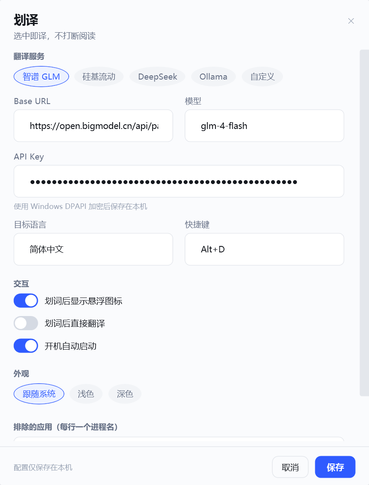

# 划译 · SelectionTranslator

在 Windows 上选中英文，点一下鼠标旁的「译」或按 `Alt+D`，立刻看到流式中文译文。任意程序可用，不需要浏览器插件。



## 特点

- **任意程序取词**：Chrome、Edge、Word、WPS、PDF 阅读器、记事本等
- **两级取词**：UI Automation 优先，失败自动回退模拟 `Ctrl+C`，并恢复原剪贴板
- **快**：取词约 0.1 秒，首字译文通常 0.3–0.8 秒（取决于所用模型）
- **不打断阅读**：默认只弹小图标，点击才翻译；卡片点外部自动关闭
- **默认免费模型**：智谱 GLM-4-Flash，也可切换硅基流动、DeepSeek、本地 Ollama
- **隐私**：选中文本只发送到你自己配置的翻译服务；API Key 用 Windows DPAPI 加密保存
- **小**：单文件 547 KB（不含 .NET 运行时），常驻托盘

## 界面



## 快速开始

1. 安装 [.NET 8 Desktop Runtime](https://dotnet.microsoft.com/download/dotnet/8.0)（Windows x64）
2. 从 [Releases](../../releases) 下载 `SelectionTranslator.App.exe`
3. 运行后，托盘右键 →「设置」，选择翻译服务并填入 API Key
4. 在任意程序里选中英文，点「译」图标或按 `Alt+D`

默认使用智谱 GLM-4-Flash（免费），API Key 在 [open.bigmodel.cn](https://open.bigmodel.cn/) 申请。

## 配置

配置保存在 `%APPDATA%\SelectionTranslator\config.json`，日志在同目录的 `logs/`。

- 触发方式：划词图标 / 划词直接翻译 / 全局快捷键
- 翻译服务：智谱 GLM、硅基流动、DeepSeek、Ollama、自定义 OpenAI 兼容接口
- 外观：跟随系统 / 浅色 / 深色
- 排除应用：按进程名屏蔽划词

## 已知限制

- 管理员权限的窗口中取不到词，除非本程序也以管理员身份运行
- 全屏独占游戏、DRM 视频无法取词
- 终端类程序（Windows Terminal、cmd、PowerShell）只走 UI Automation，禁用模拟 `Ctrl+C`
- 没有 OCR，扫描版 PDF 和图片取不到词
- 常驻私有内存约 200–250 MB

## 构建

需要 .NET 8 SDK：

```bash
dotnet build SelectionTranslator.sln
dotnet test src/SelectionTranslator.Tests/SelectionTranslator.Tests.csproj
```

发布并安装到本机：

```bash
dotnet publish src/SelectionTranslator.App -c Release -r win-x64 --self-contained false -p:PublishSingleFile=true -o publish/framework-dependent
powershell -ExecutionPolicy Bypass -File scripts/install.ps1
```

## 项目结构

- `src/SelectionTranslator.Core`：取词、翻译、配置，无 UI 代码
- `src/SelectionTranslator.App`：WPF 宿主、托盘、悬浮窗
- `src/SelectionTranslator.Tests`：48 个单元测试
- `docs/superpowers`：设计文档与实现计划

## 致谢

系统级取词方案参考了 [STranslate](https://github.com/STranslate/STranslate)（MIT）；产品形态参考了 [pot-app](https://github.com/pot-app/pot-desktop)（GPL-3.0）。本项目没有复制上述项目的代码。

## License

[MIT](LICENSE)